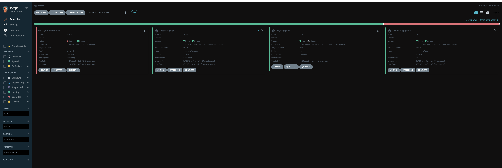
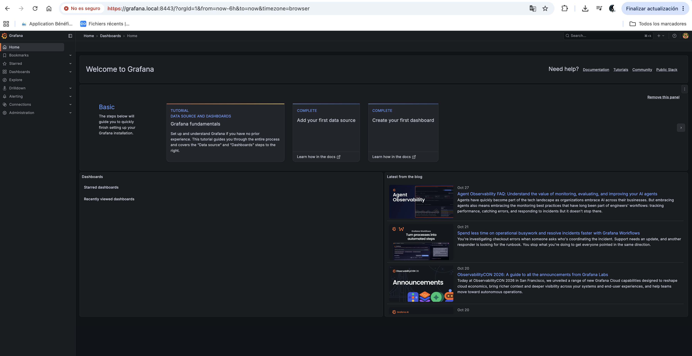
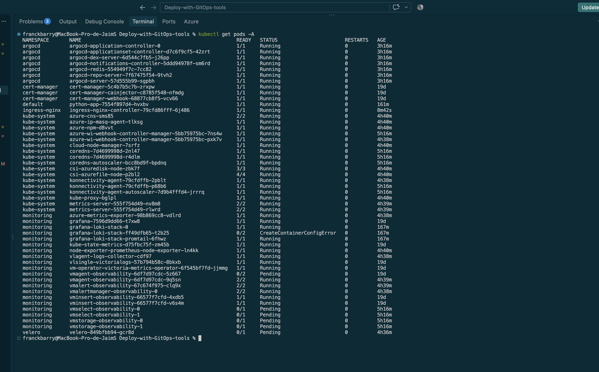
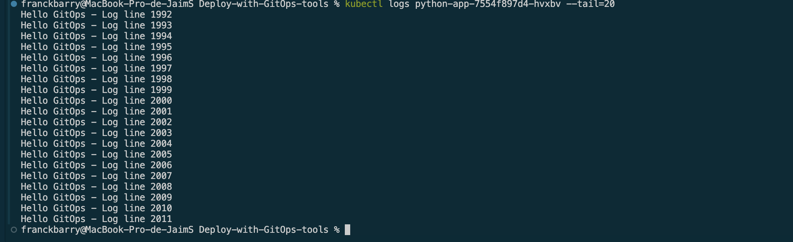

# Projet ECF - Déploiement Kubernetes avec GitOps

Ce projet présente la mise en place d'une infrastructure sur Azure (AKS) et le déploiement continu d'une application via une démarche GitOps.

## 📁 Structure du projet

- `terraform/` : Fichiers d'infrastructure as Code pour créer le cluster AKS.
- `manifests/` : Manifestes Kubernetes pour l'application et l'ingress.
- `observability/` : Fichiers de configuration pour Loki et Grafana (avec les captures d'écran).

---

## 🚀 Fonctionnement & Captures d'écran

### 1. Synchronisation GitOps (ArgoCD)
ArgoCD est configuré pour surveiller le dépôt Git et déployer automatiquement les modifications sur le cluster Kubernetes.

### 2. Supervision et Accès Sécurisé (Grafana HTTPS)
Grafana est accessible en HTTPS via l'Ingress NGINX configuré sur le cluster.

### 3. État du cluster Kubernetes
Vérification des pods et des services actifs sur le cluster AKS.

### 4. Exécution et logs de l'application
L'application Python tourne dans le cluster et génère ses logs de fonctionnement.

---

## 💡 Choix techniques et d'architecture

- **ArgoCD (GitOps)** : Permet d'avoir une infrastructure déclarative. Si le cluster a un problème, ArgoCD réapplique automatiquement la bonne configuration depuis Git sans intervention manuelle.
- **Séparation des dépôts Git** : Le code de l'application et les manifestes Kubernetes sont séparés pour éviter de casser la configuration de déploiement lors d'une simple modification de code.
- **Stack de monitoring légère** : Utilisation de Loki et VictoriaMetrics à la place d'outils plus lourds pour économiser le CPU et la mémoire sur le cluster.